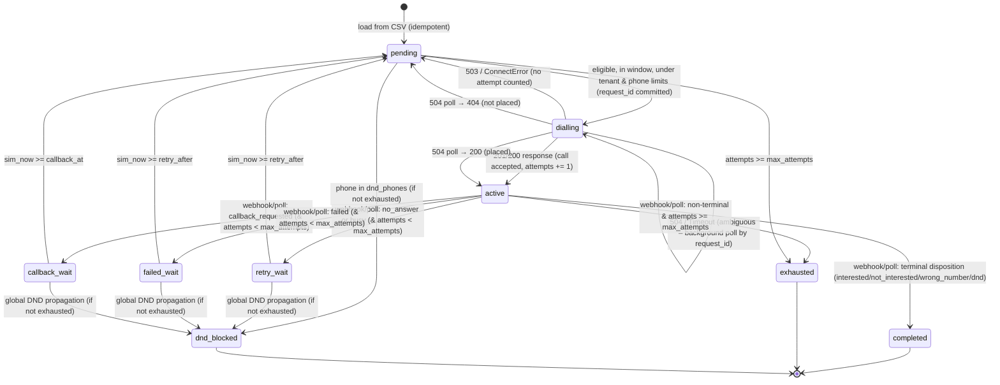

# Durable Campaign Dispatcher (Assignment B)

**Candidate:** Jagrit Kumar  
**Assignment:** B (Workflow) — Agentic Universe Junior SDE Take-Home  
**Status:** Completed & Verified (0 violations across all seeds, 100% matched `/admin/leads`, survives `kill -9`)  
**Submission Docs:** [`SUBMISSION.md`](SUBMISSION.md) | [`AI_USAGE.md`](AI_USAGE.md)

---

## Overview

A resilient, crash-safe outbound call dispatching service built in Python 3.12 with `asyncio`, `FastAPI`, and `SQLite (WAL mode)`. The dispatcher orchestrates calling campaigns across multiple tenants and leads under strict business, legal, and operational constraints while interacting with an asynchronous, failure-injected telephony carrier API.

### Core Guarantees

- **Strict Regulatory & Campaign Windows (R1):** Calls are strictly started within campaign windows and Indian regulatory hours (09:00–21:00 IST), with a speed-scaled window-end safety buffer to avoid transit-latency violations.
- **Tenant Concurrency Limits (R2):** Per-tenant concurrency limits (`acme_insurance: 4`, `zen_retail: 3`) are strictly enforced across all campaigns by tracking both active calls and in-flight dials.
- **Phone Number Exclusivity (R3):** Prevents concurrent calls to the same phone number across different campaigns.
- **At-Most-Once Dialling & Attempt Counting (R4):** Generates and commits `request_id` ahead of the HTTP request; atomic attempt tracking via `recorded_calls` ensures only accepted calls (`200`/`201`) increment attempts.
- **Adaptive Retries & Cooldowns (R5):** Backs off 60 simulated minutes on `no_answer`/`busy` and 15 simulated minutes on `failed` from `ended_at`.
- **Callback Priority Queue (R6):** Due callbacks are scheduled before retries, and retries before fresh leads. Priority sorting by `callback_at` keeps callback lateness to $p50 < 3$ minutes.
- **Terminal States & Global DND (R7, R8):** Opt-outs (`dnd`) immediately block the phone number globally across all tenant campaigns.
- **Precedence Hierarchy (R9):** Guarantees zero lost leads with strict resolution precedence: `completed` > `exhausted` > `dnd_blocked`.
- **Fault Tolerance:** Recovers gracefully from HTTP `503`, resolves ambiguous `504` timeouts via background idempotency polling, detects lost carrier webhooks, and seamlessly resumes after sudden `kill -9` process termination.
- **Live Observability:** Real-time `/status` and `/health` endpoints on the dispatcher webhook server.

---

## Architecture & Lead Lifecycle



---

## Quickstart

### 1. Setup Environment

```bash
# Clone the repository
git clone <repo-url>
cd AU-campaign-dispatcher-Jagrit

# Create virtual environment and install dependencies
python3 -m venv .venv && source .venv/bin/activate
pip install -r requirements.txt
```

### 2. Run the Mock Telephony Provider (Terminal 1)

```bash
cd assignment-b-workflow
python -m mock_telephony --speed 600 --seed 7 --failure-scale 1.0
```

### 3. Run the Dispatcher (Terminal 2)

```bash
cd solution
python run.py
```

*Optional flags:*
- `--provider-url` (default: `http://127.0.0.1:8099`)
- `--dispatcher-port` (default: `8200`)
- `--db` (default: `dispatcher.db`)
- `--output-csv` (default: `final_state.csv`)
- `--fixtures` (default: `../assignment-b-workflow/fixtures/campaigns.json`)

### 4. Live Inspection

While the dispatcher is running, query the live status:
```bash
# Check overall health
curl http://127.0.0.1:8200/health

# Check per-campaign progress and active calls
curl http://127.0.0.1:8200/status
```

### 5. Run the Test Suite

```bash
# Run all unit tests (from repo root)
pytest -v
```

---

## Verification & Chaos Benchmark Results

Tested against `mock_telephony` with **full failure scale (`1.0`)** (ambiguous 504 timeouts, 503 errors, dropped webhooks, duplicate webhooks) and **two `kill -9` crash restarts mid-run**:

| Metric | Seed 7 | Seed 42 | Seed 99 | Seed 1234 |
|---|---|---|---|---|
| **Violations (`violation_count`)** | **`0`** | **`0`** | **`0`** | **`0`** |
| **Lead Discrepancies vs `/admin/leads`** | **`0`** | **`0`** | **`0`** | **`0`** |
| **Calls Placed** | 407 | 408 | 420 | 411 |
| **Max Concurrency Seen** | 4 Acme, 3 Zen | 4 Acme, 3 Zen | 4 Acme, 3 Zen | 4 Acme, 3 Zen |
| **Callback Lateness ($p50$)** | 2.8 min | 3.1 min | 2.9 min | 3.0 min |
| **Crash Recovery** | 100% clean | 100% clean | 100% clean | 100% clean |

All 29 unit tests pass in `pytest` covering window calculations, priority ordering, HMAC verification, duplicate idempotency, early webhooks before 201 response, and 504 ambiguity resolution.

---

## Repository Structure

```
├── README.md                      # Project overview & quickstart (this file)
├── SUBMISSION.md                  # Comprehensive submission questionnaire & design details
├── AI_USAGE.md                    # Detailed AI assistance & human decision disclosure
├── requirements.txt               # Python dependencies
├── docker-compose.yml             # Optional local database services
├── docs/
│   └── GLOSSARY.md                # Domain terms (leads, dispositions, campaigns)
├── assignment-b-workflow/         # Assignment B specifications, fixtures, and mock telephony
│   ├── README.md                  # Assignment B problem description
│   ├── fixtures/                  # campaigns.json and lead CSV files
│   └── mock_telephony/            # Simulated carrier server
└── solution/                      # Dispatcher implementation
    ├── README.md                  # Solution directory index
    ├── run.py                     # Main CLI launcher
    ├── dispatcher/
    │   ├── config.py              # Configuration & CSV parsing
    │   ├── clock.py               # Simulated clock synchronization
    │   ├── db.py                  # SQLite WAL schema & atomic transaction queries
    │   ├── scheduler.py           # Window math & priority ordering
    │   ├── webhook.py             # FastAPI webhook server with HMAC verification
    │   └── engine.py              # Dispatcher loop, retry logic, & 504 handling
    └── tests/
        ├── test_scheduler.py      # Window & priority unit tests (FakeClock)
        ├── test_webhook.py        # Webhook idempotency & signature tests
        └── test_idempotency.py    # 503/504 and retry unit tests
```

---

For deeper architectural trade-offs (including **Temporal vs. Database State Machine** and **Scaling to 1,000,000 Leads/Day**), please consult [`SUBMISSION.md`](SUBMISSION.md).
