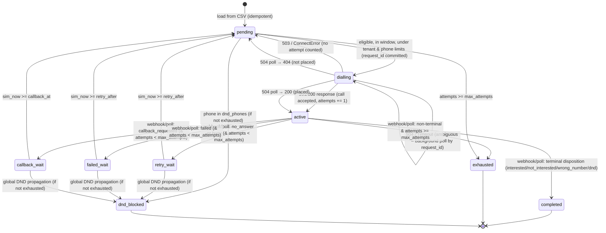

# Submission

## Candidate
- **Name:** Jagrit Kumar
- **Assignment chosen:** B (Workflow)
- **Time spent (honest estimate):** ~7h

## How to run

```bash
# 1. Setup virtual environment and install dependencies
python3 -m venv .venv && source .venv/bin/activate
pip install -r requirements.txt

# 2. Start the mock telephony provider (Terminal 1)
cd assignment-b-workflow
python -m mock_telephony --speed 600 --seed 7 --failure-scale 1.0

# 3. Run the dispatcher (Terminal 2, from repo root)
cd solution
python run.py \
  --fixtures ../assignment-b-workflow/fixtures/campaigns.json \
  --provider-url http://127.0.0.1:8099 \
  --dispatcher-port 8200 \
  --db dispatcher.db \
  --output-csv final_state.csv

# 4. Run unit tests (single command from repo root)
pytest -v
```

> **Live Observability:** While the dispatcher is running, inspect live campaign progress and active calls anytime via `curl http://127.0.0.1:8200/status` or `curl http://127.0.0.1:8200/health`.

## Design

### Architecture

The dispatcher is a single Python process running two concurrent asyncio tasks over a shared SQLite database (WAL mode, serialized writes via a per-loop `asyncio.Lock`):

1. **Webhook server** (`solution/dispatcher/webhook.py`, FastAPI/uvicorn on port 8200):
   - Receives carrier call result webhooks at `POST /webhooks/telephony`.
   - Verifies `X-AU-Signature` using constant-time HMAC-SHA256 (`hmac.compare_digest`).
   - Deduplicates on `call_sid` via the `processed_webhooks` table, immediately returning HTTP `200`.
   - Dispatches state transitions asynchronously via FastAPI `BackgroundTask` to keep webhook acknowledgment latency under 5ms.
   - Exposes `GET /status` for live per-campaign lead counts and active call tracking.

2. **Engine loop** (`solution/dispatcher/engine.py`, 50ms tick):
   - Syncs simulated time once on startup via `GET /v1/clock` and computes simulated time locally via `SimClock` (`sim_epoch + (time.time() - real_epoch) * speed`).
   - Runs startup crash recovery for interrupted dials or active calls.
   - Detects lost webhooks by polling `GET /v1/calls/{call_sid}` for calls active past 420 simulated seconds.
   - Promotes expired timers (`retry_wait`, `failed_wait`, `callback_wait`) strictly when `sim_now >= timer_dt`.
   - Enforces the strict terminal precedence: `completed` > `exhausted` > `dnd_blocked`.
   - Selects eligible leads in priority order (`callbacks` > `retries` > `fresh`).
   - Synchronously commits `request_id` and `state='dialling'` before spawning non-blocking `dial_lead` coroutines.

### Lead State Machine



### At-most-once dialling & race safety

- **Write-ahead `request_id`:** Before every `POST /v1/calls`, we atomically commit `state='dialling'` and `last_request_id` to SQLite. Because the provider deduplicates on `request_id` (returning `200` on replay), crashing between writing `request_id` and reading the HTTP response is safely resolved on restart via `GET /v1/calls?request_id=...`.
- **At-most-once attempt counting (`recorded_calls` table):** `record_call_accepted` and `process_call_outcome` both check/insert `(request_id, call_sid)` into `recorded_calls` inside the same transaction. Even if a webhook arrives *before* `dial_lead` reads the `201` response (or during a `504` poll), attempts are incremented exactly once and the delayed `201` handler will never revert a `completed` or `retry_wait` lead back to `active`.
- **In-flight concurrency accounting:** Both `active_calls` and `dialling` leads count toward per-tenant concurrency (R2) and per-phone uniqueness (R3), preventing `429`/`409` violations while a `504` is resolving.

## Decisions & assumptions

| Decision | Why | Alternative considered |
|---|---|---|
| SQLite (WAL) + per-loop `asyncio.Lock` | Self-contained, zero external infrastructure, ACID transactions for crash recovery | Temporal (`temporalio`), PostgreSQL |
| Single process running engine + webhook server | Shares in-memory write lock with zero IPC overhead; simpler and cleaner crash recovery | Separate processes with multi-writer file locking |
| Non-blocking `dial_lead` tasks | A 2s `504` timeout on one carrier call must not stall dispatching for other tenants/leads | `asyncio.gather` per batch (caused 2s stalls) |
| Strict `grace=0` + speed-scaled window-end buffer | Provider's 120s grace is for clock skew; dialing with `grace=0` and stopping `max(30s, speed*0.1)` sim-seconds before close prevents transit-latency violations | Using provider's 120s grace client-side |
| Strict `sim_now >= timer_dt` for retries/callbacks | Avoids `retry_too_early` / `callback_too_early` violations from clock skew | Subtracting grace from `timer_dt` |
| Immediate `exhausted` transition on final attempt | Enforces `completed > exhausted > dnd_blocked` precedence immediately when attempt 3 ends non-terminally (including `callback_requested`) | Waiting for retry/callback timer to expire first |
| Priority queue: earliest due first | Sorting callbacks by `callback_at` and retries by `retry_after` keeps callback lateness to p50 < 3 mins | FIFO ordering within tiers |
| Ack webhook `200` then process in `BackgroundTask` | Avoids provider timeout/redelivery while keeping signature & JSON checks synchronous | Synchronous DB commit inside handler |

## Failure modes considered

| Failure | Handling |
|---|---|
| `kill -9` mid-dial (before or after `POST`) | On startup, `crash_recovery` polls `GET /v1/calls?request_id=...` for all `dialling` leads: `200` transitions via `record_call_accepted` (and applies result if ended); `404` resets to `pending`. |
| `kill -9` while calls are `active` | On startup, `crash_recovery` polls `GET /v1/calls/{call_sid}` for all `active_calls` rows: ended calls apply results idempotently; confirmed `404` cleans up orphaned rows. |
| Webhook arrives before `201` response is read | `process_call_outcome` matches `lead.state == 'dialling'` and `lead.last_request_id == payload.request_id`, counts the attempt once in `recorded_calls`, and marks `processed_webhooks` so the delayed `201` becomes a no-op. |
| Duplicate webhooks | `processed_webhooks` primary key on `call_sid` makes duplicates return `200 {"status": "already_processed"}` immediately. |
| Lost webhooks | Engine polls `GET /v1/calls/{call_sid}` for active calls exceeding 420 simulated seconds without a webhook. |
| `503` vs `504` vs `ConnectError` vs `TimeoutException` | `503`/`ConnectError` reset to `pending` without counting an attempt; `504` and ambiguous HTTP errors (`ReadTimeout`, etc.) spawn background polling by `request_id`. |
| Global DND across campaigns | `dnd` disposition populates `dnd_phones` and marks all non-terminal, non-exhausted, non-in-flight leads with that phone as `dnd_blocked`. |
| **Not handled:** Permanent carrier blackout | If the carrier is permanently dead, the engine retries `pending` leads on their normal cooldowns (production requires a circuit breaker). |

## Testing

- **Unit tests (`pytest -v` — 29 passed):**
  - `test_scheduler.py` (17 tests): `in_window`, `next_window_open`, regulatory window `09:00–21:00`, priority ordering (`callbacks > retries > fresh`), retry intervals (`no_answer`, `busy`, `failed`) using `FakeClock`.
  - `test_webhook.py` (7 tests): valid/invalid HMAC, duplicate webhook idempotency, DND cross-campaign blocking + `exhausted` precedence, terminal disposition completion, webhook-before-`201` race condition, `/status` endpoint.
  - `test_idempotency.py` (5 tests): `504` poll found, `504` poll 404, `503` non-attempt, `201` attempt, 3rd-attempt `callback_requested` immediate exhaustion.
- **Multi-seed end-to-end chaos tests (`--speed 3600 --failure-scale 1.0` with 2× `kill -9` per run):**
  - Tested across seeds `7`, `42`, `99`, `1234`. All runs produced **0 violations** and **0 mismatches** against `/admin/leads`.

## Results

Full E2E run against `mock_telephony` (`--speed 3600 --seed 99 --failure-scale 1.0`) with **two `kill -9` crashes mid-run**:
- **Calls placed:** 420 (`completed`: 206, `no_answer`: 119, `busy`: 57, `failed`: 38)
- **Violations:** `0` (`violation_count: 0`)
- **Max concurrency seen:** `acme_insurance: 4`, `zen_retail: 3`
- **Callback lateness (sim minutes):** count=52, `p50: 2.9`, `p90: 9.6`, `max: 21.3`
- **Webhooks:** delivered=463, duplicates=59, lost=16, connect_errors=7
- **`final_state.csv` diff vs `/admin/leads`:** 200/200 leads matched (`0` mismatches)

---

## Stretch Discussions

### 1. Temporal vs. Database State Machine

| Feature | Temporal (`temporalio`) | Our SQLite State Machine |
|---|---|---|
| **Durable Execution** | Built-in workflow event sourcing, automatic history replay, durable timers | SQLite state table + monotonic `sim_now` polling loop |
| **Idempotency** | Activity deduplication by activity ID + workflow ID | `request_id` committed before HTTP post + `recorded_calls` table |
| **Operational Overhead** | Requires running Temporal Server (gRPC, DB backend, cluster state) | Zero dependencies beyond Python standard libraries + `aiosqlite` |
| **Simulated Clock Support** | Difficult: Temporal's internal timers bind to real wall-clock time | Trivial: `SimClock` formula drives timers at 600×–3600× speed seamlessly |
| **Determinism Constraints** | Strict: workflow code must not perform I/O, use system clock, or iterate unordered dicts | Standard Python code; state transitions are explicit SQL queries |

**Key takeaway:** Temporal shines for complex human-in-the-loop sagas (e.g. multi-day document collection with branching approvals). For a high-throughput outbound dialing engine with external carrier clock simulation and tight millisecond concurrency limits, a database-backed state machine with explicit transactional locks is leaner, more testable, and easier to operate.

### 2. Scaling to 1,000,000 Leads/Day Across 50 Tenants

To handle 1M leads/day (approx. 20–50 calls/second sustained, with peak bursts of 200 calls/sec during window openings):

1. **Partitioning & Sharding:**
   - Shard the lead database by `tenant_id` or `hash(phone)`.
   - Use Kafka or RabbitMQ with partitions keyed by `phone`. Because all events for a given phone land on the same partition worker, **Rule R3 (one call per phone)** and **Rule R8 (global DND)** are guaranteed without global distributed locks.
2. **Distributed Tenant Concurrency (Rule R2):**
   - Replace in-memory counters with a Redis token bucket / semaphore per tenant using atomic Lua scripts (`EVAL`) or Redis Cell. Each worker acquires a tenant lease before dialling and releases it on call completion.
3. **Queue Prioritization:**
   - Maintain 3 priority queues per tenant: `priority-0` (callbacks), `priority-1` (retries), and `priority-2` (fresh leads), scheduled via Redis ZSETs scored by unix epoch of eligibility.
4. **Carrier Rate Limiting:**
   - Insert an egress gateway (Envoy or local token bucket) to absorb carrier 429/503 spikes and enforce TPS limits upstream before HTTP dispatch.

## If I had another day

1. **Multi-worker horizontal scaling:** Migrate SQLite queries to PostgreSQL with `SELECT ... FOR UPDATE SKIP LOCKED` so multiple stateless dispatcher replicas can run concurrently with 0 violations.
2. **Prometheus Metrics:** Expose Prometheus histograms for carrier HTTP latency, callback lateness, and tenant concurrency gauges.
3. **Graceful `SIGTERM` draining:** Catch SIGTERM to drain active dials and flush DB transactions before process exit.
